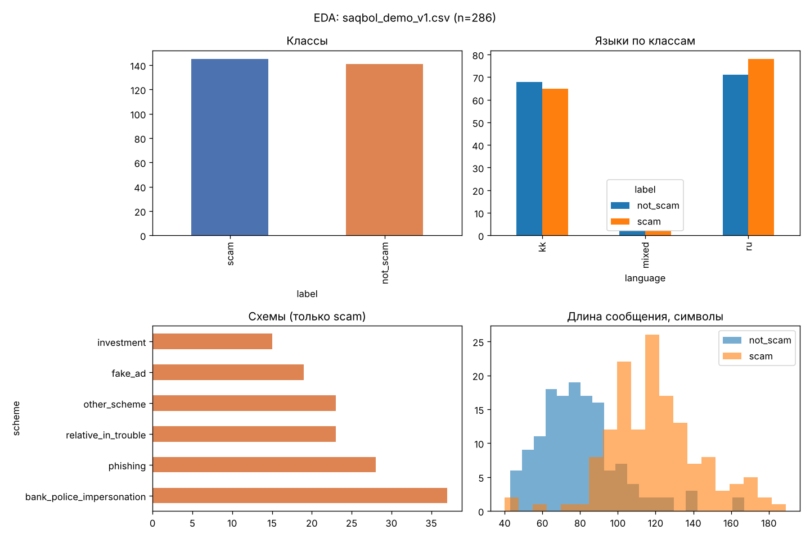

# EDA: abayla_demo_v1.csv

Строк: 286, групп шаблонов: 141 (в среднем 2.03 текста на группу).
Ошибки валидации: нет; предупреждения: нет.
Пропуски: {'id': 0, 'text': 0, 'label': 0, 'scheme': 0, 'language': 0, 'source_type': 0, 'source_id': 0, 'template_group': 0, 'annotation_status': 0}.
Точные дубликаты: 0; после нормализации цифр и пунктуации: 0.

| Срез | Значения |
|---|---|
| Классы | {'scam': 145, 'not_scam': 141} |
| Языки | {'ru': 149, 'kk': 133, 'mixed': 4} |
| Схемы | {'none': 141, 'bank_police_impersonation': 37, 'phishing': 28, 'relative_in_trouble': 23, 'other_scheme': 23, 'fake_ad': 19, 'investment': 15} |
| Источники | {'synthetic_demo': 286} |
| Статус разметки | {'verified': 280, 'disputed': 4, 'pending': 2} |
| Доля сообщений со ссылкой | {'not_scam': 0.064, 'scam': 0.228} |

Длина в символах по классам (mean / 50% / max):
- not_scam: 79.8 / 78.0 / 167.0
- scam: 120.0 / 118.0 / 189.0

